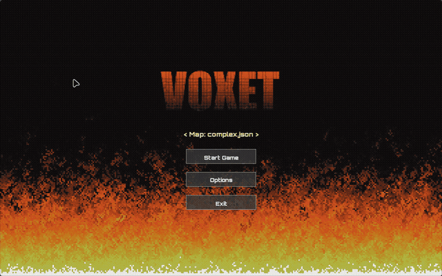

# 🌀 VoxetGameEngine

**VoxetGameEngine** — это 2.5D секторный игровой движок на **C++** и **SFML**, созданный в духе классических движков 90-х (_Doom / Build Engine_). Движок сочетает ретро-эстетику с современным архитектурным подходом: рекурсивный рендеринг порталов, виртуальное разрешение UI, GLSL-шейдеры и процедурные визуальные эффекты.

---

## 📽️ Демонстрация (Preview)



---

## ✨ Ключевые Возможности

### 📐 Секторная Геометрия и Порталы

- **Секторная архитектура:** Разноуровневые полы и потолки (`floorHeight`, `ceilingHeight`), индивидуальные текстуры и уровни освещения.
- **Портальная система:** Бесшовные переходы между секторами, поддержка ступеней, окон и дверных проёмов(в разработке).
- **Двухмерная коллизия:** Проверка пересечения со стенами с учётом высоты шага (`STEP_HEIGHT`).
- **JSON-Формат карт:** Легко читаемый и редактируемый текстовый формат хранения геометрии уровней.

### 🎨 Рендеринг и Визуальные Эффекты

- **Двухуровневый рендеринг:**
  - Внутренний низкополигональный 3D-буфер для ретро-картинки.
  - Фиксированный виртуальный интерфейс **1920x1200** (`VIRTUAL_WIDTH` / `VIRTUAL_HEIGHT`) с автоматической коррекцией соотношения сторон (letterboxing/pillarboxing).
- **Динамическое освещение:** Квадратичное затухание света от расстояния, локальное освещение и эффекты вспышки выстрела (_Muzzle Flash_).
- **Процедурный эффект огня (`FireEffect`):** Классический алгоритм огня (PSX/Doom style) с палитрой из 37 цветов и стартовой вспышкой.
- **GLSL-Шейдеры:** Попиксельный диагональный блик (под 45°) на логотипе `VOXET` с квантованием яркости под ретро-стиль.
- **Анимированный UI:** Подъем логотипа из огня, органическая микро-дрожь и плавное появление элементов управления.

---

## 🏗️ Структура Проекта

```text
VoxetGameEngine/
├── assets/                  # Игровые ресурсы
│   ├── fonts/               # Шрифт (Orbitron-Black.ttf)
│   ├── maps/                # Карты уровней (*.json)
│   ├── textures/            # Текстуры стен, пола и потолка
│   └── VOXET.png            # Логотип главного меню
├── include/
│   ├── Core/                # Менеджеры состояний и ресурсов
│   ├── Rendering/           # SectorRenderer, FireEffect
│   ├── States/              # MenuState, PlayState, PauseState, OptionsState
│   ├── UI/                  # Кнопки и виртуальный интерфейс
│   ├── Utils/               # settings.h (VIRTUAL_WIDTH/HEIGHT)
│   └── World/               # Sector, Wall, SectorMap, MapLoader
├── src/                     # Исходный код C++
├── docs/                    # Документация и медиа-файлы
├── CMakeLists.txt           # Скрипт сборки CMake
└── settings.cfg             # Конфигурация пользователя

```

---

## ⚙️ Требования и Сборка

### Зависимости

- **C++20** совместимый компилятор (GCC, Clang, MSVC)
- **CMake** (v3.16+)
- **SFML** (v2.6+ / v3.0+)
- **OpenGL** (для поддержки GLSL шейдеров)

### Сборка под Linux (Arch / Ubuntu)

```bash
# 1. Клонирование репозитория
git clone [https://github.com/ReBuss666/VoxetGameEngine.git](https://github.com/ReBuss666/VoxetGameEngine.git)
cd VoxetGameEngine

# 2. Конфигурация CMake
cmake -B build -DCMAKE_BUILD_TYPE=Release

# 3. Компиляция
cmake --build build -j$(nproc)

# 4. Запуск
./build/VoxetGameEngine

```

---

## 🎮 Управление

| Раздел              | Клавиша / Действие       | Функция                              |
| ------------------- | ------------------------ | ------------------------------------ |
| **Главное меню**    | `Стрелки Влево / Вправо` | Переключение карт                    |
|                     | `ЛКМ` / `Enter`          | Выбор пункта меню / Пропуск анимации |
| **Игровой процесс** | `W`, `A`, `S`, `D`       | Перемещение                          |
|                     | `Мышь`                   | Обзор (Lock Mouse)                   |
|                     | `Space` / `Shift` / `C`  | Прыжок / Бег / Присесть              |
|                     | `ЛКМ`                    | Выстрел (с Muzzle Flash)             |
|                     | `ESC`                    | Пауза / Освободить мышь              |

---
